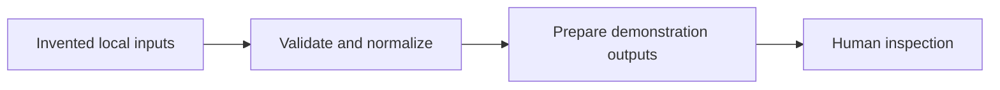

# Architecture

[Portfolio](README.md) | [Publication checklist](PUBLICATION-CHECKLIST.md)

The repository contains three runnable Python demonstrations using invented
local data. The four case studies explain workflow concepts; they do not claim
that the operational implementations have been published or independently
validated. The demonstrations use their own simplified schemas and generic
layouts rather than operational source files, corporate templates, or live
source-service integrations.

## Data flow

| Demo | Inputs | Processing | Outputs |
|---|---|---|---|
| [Report composer](demos/README.md) | Invented JSON report record | Validate values, preserve input order, populate generic layouts | Two DOCX drafts and an HTML preview |
| [Reference monitor](demos/MONITOR.md) | Invented local RSS/HTML, generated spreadsheet, fictional interests, optional prior checkpoint | Normalize records, identify changed versions, match interests | JSON review queue, HTML preview, immutable checkpoint |
| [Archive builder](demos/ARCHIVE.md) | Generated synthetic XML index and PDFs | Validate the package, render the index, assemble components and bookmarks | Preserved sources, archive note, merged PDF, hash manifest, HTML summary |

Generation and processing run offline. Initial dependency installation may use
the network. No demo authenticates to a portal, retrieves live regulatory data,
sends notifications, submits documents, or updates an operational system.

## Module boundaries

- `demos/report_composer.py` contains input validation and generic report rendering.
- `demos/reference_monitor.py` contains the two local adapters, matching, and
  checkpoint processing; `demos/monitor_fixtures.py` creates the invented spreadsheets.
- `demos/archive_builder.py` generates the fixed synthetic package and assembles it.
- `fixtures/` holds the small, readable input records; `tests/` checks both expected
  outputs and meaningful failure cases.
- `pyproject.toml` declares the core report dependencies and optional `monitor`
  and `archive` dependencies. No web application or account service is required.

## Output and review boundaries

Each command requires an explicit output location and refuses an existing output
directory. Inputs remain unchanged. Failed writes trigger cleanup of files created
by that run, but file locks can prevent cleanup; consumers must wait for a successful
exit and inspect errors. This is not a crash-safe transaction system.

The monitor's checkpoint records local processing, not notification delivery.
An exact repeat produces no new candidates; changed source records may produce new
ones. A checkpoint is not an audit signature, an exactly-once service, or proof that
all relevant source changes were captured. Matching candidates still need review.

Report outputs carry demonstration-only and not-approved notices. They are not
regulatory templates or submission-ready documents. Calendar and schema choices
are simplified demonstration rules, not regulatory requirements.

The archive preserves source bytes and checks page counts. Equal totals do not
prove correct content, order, legibility, signatures, or completeness. Hashes support
comparison, not authenticity. The archive builder is not a sanitizer or malware
scanner; use its generated fixtures rather than arbitrary or operational packages.

## Confidentiality and verification

Use only invented data. Synthetic flags, `DEMO-` identifiers, neutral metadata,
and ignore rules reduce accidental misuse but do not detect every kind of private
information or establish publication rights. Generated artifacts are excluded from
normal source publication; any selected preview needs a separate content and
metadata review before inclusion.

The [CI workflow](.github/workflows/tests.yml) specifies tests and demo runs.
Consult the [Actions results](https://github.com/dbstudioai/regulatory-workflow-automation/actions)
for the exact commit being evaluated. Passing tests establish only what those
tests check; they do not establish regulatory compliance, confidentiality,
ownership, or approval to disclose workflow concepts.

This public architecture overview is not an approval record. Keep release-specific
permission evidence, reviewer identities, and internal source references outside
the repository, following the [publication checklist](PUBLICATION-CHECKLIST.md).
