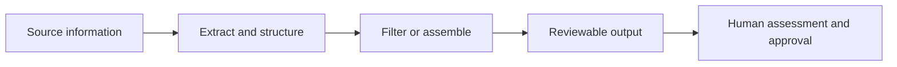

# Regulatory Workflow Automation

### Four case studies in turning repetitive regulatory work into reviewable outputs.

Monitoring reference updates. Drafting structured reports. Preparing submission archives.
This portfolio presents four automation projects through their workflow design,
engineering decisions, and human-review boundaries.

**Case studies + runnable demos | Synthetic examples | No production code or live access**

## Selected projects

| Project | The problem | The approach | Explore |
|---|---|---|---|
| **EDQM Reference Monitor** | Relevant reference updates are scattered across announcements. | Detect new publications, extract affected references, and match a configurable interest list. | [Case study](case-studies/edqm-reference-monitor.md) |
| **USP Update Review Assistant** | Reviewing change listings repeatedly involves manual filtering. | Structure an authorized export, identify unseen entries, and surface relevant matches. | [Case study](case-studies/usp-update-review-assistant.md) |
| **FDA Annual Report Composer** | Annual-report preparation repeats extraction and document-formatting work. | Extract candidate values, confirm them with a reviewer, and populate document templates. | [Case study](case-studies/fda-annual-report-composer.md) |
| **RIMS Archive Preparation Assistant** | Submission archiving requires repetitive assembly and checking. | Prepare an archive note, render the index, merge PDFs, and check page counts. | [Case study](case-studies/rims-archive-preparation.md) |

## Try the report composer

The [annual report composer](demos/README.md) generates two DOCX drafts and an HTML
preview from [invented JSON input](fixtures/reporting/annual-report.json).
It uses newly authored generic layouts, not operational code or corporate templates.

From the repository root in PowerShell, with Python 3.11 installed:

```powershell
py -3.11 -m venv .venv
.\.venv\Scripts\python.exe -m pip install -e .
.\.venv\Scripts\python.exe -m demos.report_composer --input fixtures\reporting\annual-report.json --output output\report-demo --confirm-synthetic
Start-Process .\output\report-demo\preview.html
```

Use a new output directory for each run. See the [demo instructions](demos/README.md)
for expected results, validation rules, tests, and other platforms.

## Try the offline reference monitor

The [EDQM/USP-style monitor](demos/MONITOR.md) uses invented local RSS, HTML,
and spreadsheet inputs to create a JSON review queue and an HTML preview.
It never connects to either source service.

Follow the [three-run walkthrough](demos/MONITOR.md#run-the-three-scenarios):
the baseline produces **3 review candidates**, an identical repeat produces **0**,
and a revised fixture produces **1**. Each run preserves its own checkpoint.

## Try the offline archive builder

The [archive demo](demos/ARCHIVE.md) generates an invented submission package and
assembles a five-page PDF with four bookmarks, a hash manifest, and an HTML summary.
It preserves the source XML/PDFs and checks the merged page count. No RIMS access,
corporate filing rules, or real submission records are used.

## One design principle: automate preparation, preserve judgment



The projects address different workflows but share a practical goal:
make repetitive preparation easier to inspect, without presenting automation as
a substitute for regulatory expertise.

### Engineering themes

- **Stateful monitoring:** distinguish newly observed entries from previously processed ones.
- **Focused relevance:** separate source collection from interest-list matching.
- **Human confirmation:** treat extracted report values as candidates, not approved facts.
- **Document assembly:** produce consistent drafts and navigable archive packages.
- **Explicit boundaries:** keep review, approval, submission, and system closure visible.

## What is available here

- Four concise case studies with architecture diagrams and limitations.
- A runnable [report composer](demos/README.md) with generic source code, invented
  input, document generation, an HTML preview, and automated tests.
- A runnable [offline reference monitor](demos/MONITOR.md) with two local input
  adapters, matching reasons, repeat suppression, and immutable run checkpoints.
- A runnable [archive builder](demos/ARCHIVE.md) with invented PDF fixtures,
  bookmarks, page-count verification, and a hash manifest.
- [Synthetic walkthroughs](examples/README.md) illustrating inputs and outputs.
- An [architecture overview](ARCHITECTURE.md) describing the three runnable demos,
  their data flow, and their boundaries.
- A [publication checklist](PUBLICATION-CHECKLIST.md) covering disclosure, ownership,
  metadata, and Git history.

The descriptions are based on project workflow documentation. Production
implementations have not been independently tested or audited as part of this
showcase. The walkthroughs are manually authored illustrations, not captured runs;
the separate demos generate actual files from synthetic fixtures.
No performance measurements, compliance certification, or deployment claims are made.

## Scope and confidentiality

This repository is publicly accessible. Public availability, passing tests, and
synthetic labels do not establish ownership or permission to disclose the source
workflow concepts. The [publication checklist](PUBLICATION-CHECKLIST.md) is a
review template, not an approval record; release-specific permissions and evidence
belong in private records outside this repository.

This repository intentionally excludes production source code, real reports,
submission packages, internal procedures, interest lists, account details,
browser sessions, and operational logs. All example records and identifiers are
invented; they do not represent actual products or submissions.

EDQM, USP, FDA, and RIMS are used only to explain the project domains.
No affiliation with or endorsement by an authority, standards body, employer,
or software vendor is claimed.

Nothing here grants access to restricted services or permission to redistribute
third-party content. No licensed reference text or live scraping instructions
are included. All document examples are **demonstration only, not for regulatory
submission**.

## Reading order

Start with a case study, compare its workflow with the
[synthetic examples](examples/README.md), try the [report](demos/README.md),
[monitor](demos/MONITOR.md), or [archive](demos/ARCHIVE.md) demo, then review the
[publication checklist](PUBLICATION-CHECKLIST.md) before adapting or publishing material.
