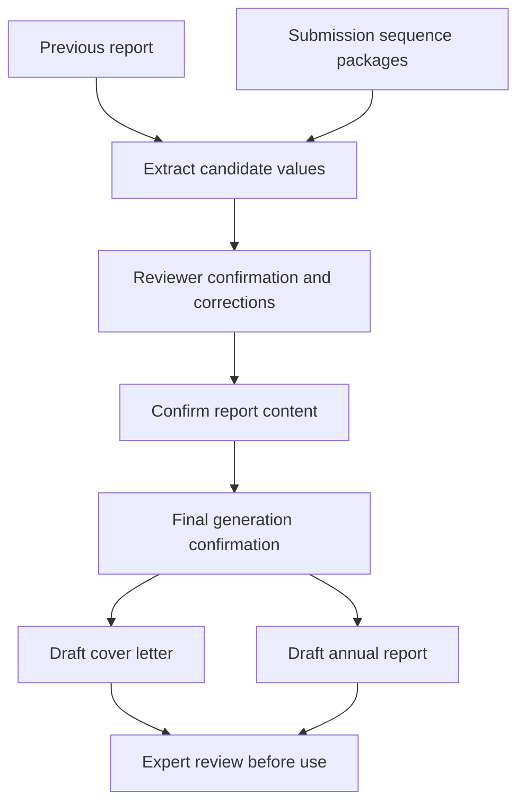

# FDA Annual Report Composer

> From scattered submission history to structured document drafts.

[Portfolio](../README.md) | [Runnable demo](../demos/README.md) |
[Synthetic walkthrough](../examples/README.md#3-fda-annual-report-composer)

## Try the generic demonstration

The [standalone report composer](../demos/README.md) generates two DOCX drafts and
an HTML preview from invented structured data. It uses newly authored layouts,
not the operational implementation or corporate templates. It does not perform
the extraction or submission-package scanning described below.

## Problem

Annual-report preparation involves carrying forward reference information,
reviewing submission sequences, and repeatedly formatting cover letters and
report tables. Extraction and formatting can be automated; the accuracy and
completeness of the report still require expert review.

## Workflow

The documented implementation reads a previous report and scans submission
sequence packages for candidate metadata. It presents findings for confirmation,
allows values to be corrected, and gathers additional information interactively.

After a final confirmation, it populates document templates to produce a draft
cover letter and annual report. The case study focuses on structured drafting
and reviewer confirmation; operational table layouts and organization-specific
report content are outside its scope.

## Engineering decisions

- **Confirm before generating.** Extracted metadata is a starting point, not
  an authoritative record.
- **Separate content from layout.** Templates support consistent document
  structure while input values vary.
- **Use submission history as context.** Sequence metadata helps assemble a
  candidate amendment list rather than requiring complete manual transcription.

## Review boundaries and limitations

Document parsing depends on source structure and consistency. Missing sequence
packages or incomplete prior reports can yield incomplete drafts. Suggested
sequence values and dates must be verified rather than accepted automatically.

Template generation does not establish that a report meets current regulatory
requirements. This project is not affiliated with or approved by the FDA, and
does not submit documents.

This portfolio contains no real templates, signatures, authorization lists,
application identifiers, or report extracts. The walkthrough is a conceptual text
preview; the runnable demo separately generates fictional, unapproved documents.

## What this case study demonstrates

Document and sequence-metadata extraction, interactive confirmation, template
population, and separation of drafting from approval. Implementation behavior
is described from documentation, not independently verified here.
