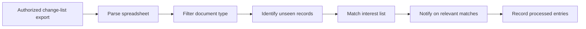

# USP Update Review Assistant

> From an authorized change listing to relevant review candidates.

[Portfolio](../README.md) | [Synthetic walkthrough](../examples/README.md#2-usp-update-review-assistant)

## Try the offline demonstration

The [reference-monitor demo](../demos/MONITOR.md) generates an invented local
spreadsheet, filters monographs, and demonstrates exact and substring matching.
It does not access the USP portal or use a subscription export. Its input schema
and full-record fingerprint are demonstration choices, not a reproduction of an
operational export format or tracking scheme.

## Problem

Repeatedly opening a change listing, filtering document types, and comparing
entries against an interest list is time-consuming preparation work. The
important output is a focused set of candidates for expert review.

## Workflow

The documented workflow starts from an authorized change listing. It structures
the records, retains relevant document types, and compares them with saved
processing state. Source acquisition and access arrangements are outside this
case study and the runnable demonstration.

New records are matched against an interest list using exact and substring
name matching. Relevant matches produce a notification containing review
context. Observed entries are then recorded in processing state.

The diagram summarizes the workflow; notification is conditional on a match,
while processing state also includes observed nonmatching entries.

## Engineering decisions

- **Use an exported table as the parsing boundary.** Structured rows separate
  the matching workflow from the portal presentation.
- **Track change identity.** Distinguish a newly observed version from a record
  already reviewed, using an identity appropriate to the permitted source data.
- **Include match context.** A notification should help a reviewer distinguish
  an exact-name match from a broader substring match.

## Review boundaries and limitations

Substring matching can produce false positives; naming differences can produce
missed matches. The export window, access availability, and source schema limit
what can be observed. Recording previously processed entries is not evidence
that every relevant change was captured or that notifications were delivered.

Authorized access does not by itself establish permission for automated use
or redistribution. Applicable terms and permissions must be checked separately.
This portfolio includes no login automation, credentials, cookies, real exports,
or subscription text. Its demonstration begins with an invented table.

## What this case study demonstrates

Structured-input parsing, change identity, stateful filtering, and
review-oriented matching. Implementation behavior is
described from documentation, not independently verified here.
